[TOC]
[https://blog.csdn.net/jishuxiaoniuniu/article/details/69257468](https://blog.csdn.net/jishuxiaoniuniu/article/details/69257468)  maven个版本下载
[https://archive.apache.org/dist/maven/maven-3/3.6.1/binaries/](https://archive.apache.org/dist/maven/maven-3/3.6.1/binaries/)
## git-bisect实战
[https://github.com/apache/maven](https://github.com/apache/maven)
## 发现问题
[https://github.com/hcsp/maven-issue-reproduction](https://github.com/hcsp/maven-issue-reproduction) 实战地址
项目clone到本地之后:

```
##3.6.0运行成功:
$/Users/mac/Develop/apache-maven-3.6.0/bin/mvn compile
[INFO] Scanning for projects...
[INFO] 
[INFO] -------------------< hcsp:maven-issue-reproduction >--------------------
[INFO] Building maven-issue-reproduction 1.0-SNAPSHOT
[INFO] --------------------------------[ jar ]---------------------------------
[INFO] 
[INFO] --- kotlin-maven-plugin:1.3.0:compile (compile) @ maven-issue-reproduction ---
Downloading from central: https://repo.maven.apache.org/maven2/org/jetbrains/kotlin/kotlin-compiler/1.3.0/kotlin-compiler-1.3.0.jar
Downloaded from central: https://repo.maven.apache.org/maven2/org/jetbrains/kotlin/kotlin-compiler/1.3.0/kotlin-compiler-1.3.0.jar (31 MB at 64 kB/s)
[INFO] 
[INFO] --- maven-resources-plugin:2.6:resources (default-resources) @ maven-issue-reproduction ---
[INFO] Using 'UTF-8' encoding to copy filtered resources.
[INFO] skip non existing resourceDirectory /Users/mac/IdeaProjects/maven-issue-reproduction/src/main/resources
[INFO] 
[INFO] --- maven-compiler-plugin:3.1:compile (default-compile) @ maven-issue-reproduction ---
[INFO] Changes detected - recompiling the module!
[INFO] Compiling 1 source file to /Users/mac/IdeaProjects/maven-issue-reproduction/target/classes
[INFO] ------------------------------------------------------------------------
[INFO] BUILD SUCCESS
[INFO] ------------------------------------------------------------------------
[INFO] Total time: 08:17 min
[INFO] Finished at: 2020-05-28T08:06:10+08:00
[INFO] ------------------------------------------------------------------------
## 3.6.1出错
$/Users/mac/Develop/apache-maven-3.6.1/bin/mvn compile
[INFO] Scanning for projects...
[INFO] 
[INFO] -------------------< hcsp:maven-issue-reproduction >--------------------
[INFO] Building maven-issue-reproduction 1.0-SNAPSHOT
[INFO] --------------------------------[ jar ]---------------------------------
[INFO] 
[INFO] --- kotlin-maven-plugin:1.3.0:compile (compile) @ maven-issue-reproduction ---
[ERROR] /Users/mac/IdeaProjects/maven-issue-reproduction/./common/Os.kt: (3, 12) Redeclaration: Os
[ERROR] /Users/mac/IdeaProjects/maven-issue-reproduction/common/Os.kt: (3, 12) Redeclaration: Os
[INFO] ------------------------------------------------------------------------
[INFO] BUILD FAILURE
[INFO] ------------------------------------------------------------------------
[INFO] Total time: 4.027 s
[INFO] Finished at: 2020-05-28T08:08:39+08:00
[INFO] ------------------------------------------------------------------------
[ERROR] Failed to execute goal org.jetbrains.kotlin:kotlin-maven-plugin:1.3.0:compile (compile) on project maven-issue-reproduction: Compilation failure: Compilation failure: 
[ERROR] /Users/mac/IdeaProjects/maven-issue-reproduction/./common/Os.kt:[3,12] Redeclaration: Os
[ERROR] /Users/mac/IdeaProjects/maven-issue-reproduction/common/Os.kt:[3,12] Redeclaration: Os
[ERROR] -> [Help 1]
[ERROR] 
[ERROR] To see the full stack trace of the errors, re-run Maven with the -e switch.
[ERROR] Re-run Maven using the -X switch to enable full debug logging.
[ERROR] 
[ERROR] For more information about the errors and possible solutions, please read the following articles:
[ERROR] [Help 1] http://cwiki.apache.org/confluence/display/MAVEN/MojoFailureException
```
## 步骤
首先把maven这个项目克隆到本地:
[https://github.com/apache/maven](https://github.com/apache/maven)
```
##查看maven版本
$git tag
maven-2.2.0
maven-2.2.1
maven-2.2.1-RC1
maven-2.2.1-RC2
maven-3.0
maven-3.0-RC1
maven-3.0-RC2
maven-3.0-RC3
maven-3.0-alpha-3
maven-3.0-alpha-4
maven-3.0-alpha-5
maven-3.0-alpha-6
maven-3.0-alpha-7
。。。
maven-3.5.3
maven-3.5.4
maven-3.6.0
maven-3.6.1
maven-3.6.2
maven-3.6.3
## 切换到有问题的那个版本
## 此时就可以从这份代码生成一份 maven程序,并且可以使用这个maven程序 去运行我们正常的maven构建
## 假如我们对这个maven进行一些官方没有的魔改,可以先把代码clone下来,自己修改,生成一份自己的maven程序即可
$git checkout maven-3.6.1
Note: checking out 'maven-3.6.1'.

You are in 'detached HEAD' state. You can look around, make experimental
changes and commit them, and you can discard any commits you make in this
state without impacting any branches by performing another checkout.

If you want to create a new branch to retain commits you create, you may
do so (now or later) by using -b with the checkout command again. Example:

  git checkout -b <new-branch-name>

HEAD is now at d66c9c0b3 [maven-release-plugin] prepare release maven-3.6.1
## 打包成自己的maven
## 这里只打包不允许测试
$mvn package -DskipTests
[INFO] Maven Settings ..................................... SUCCESS [ 0.476 s]
[INFO] Maven Settings Builder ............................. SUCCESS [ 1.712 s]
[INFO] Maven Repository Metadata Model .................... SUCCESS [ 0.483 s]
[INFO] Maven Artifact Resolver Provider ................... SUCCESS [02:11 min]
[INFO] Maven Core ......................................... SUCCESS [05:52 min]
[INFO] Maven SLF4J Simple Provider ........................ SUCCESS [ 10.862 s]
[INFO] Maven Embedder ..................................... SUCCESS [01:07 min]
[INFO] Maven Compat ....................................... SUCCESS [ 2.565 s]
[INFO] Apache Maven Distribution .......................... SUCCESS [16:59 min]
[INFO] ------------------------------------------------------------------------
[INFO] BUILD SUCCESS
[INFO] ------------------------------------------------------------------------
[INFO] Total time: 41:39 min
[INFO] Finished at: 2020-05-28T12:16:17+08:00
[INFO] ------------------------------------------------------------------------
#找到刚刚打包的压缩文件!
$find . -name '*.zip'
./maven-resolver-provider/target/test-classes/repo/ut/simple/artifact/1.0/artifact-1.0-classifier.zip
./maven-resolver-provider/target/test-classes/repo/ut/simple/artifact/1.0/artifact-1.0.zip
./maven-resolver-provider/src/test/resources/repo/ut/simple/artifact/1.0/artifact-1.0-classifier.zip
./maven-resolver-provider/src/test/resources/repo/ut/simple/artifact/1.0/artifact-1.0.zip
./apache-maven/target/apache-maven-3.6.1-bin.zip   (就是它了！！！)
## 解压缩刚刚找到的压缩包
$unzip ./apache-maven/target/apache-maven-3.6.1-bin.zip -d .
Archive: ./apache-maven/target/apache-maven-3.6.1-bin.zip
   creating: ./apache-maven-3.6.1/
   creating: ./apache-maven-3.6.1/lib/
   creating: ./apache-maven-3.6.1/lib/jansi-native/
   creating: ./apache-maven-3.6.1/lib/jansi-native/freebsd64/
   creating: ./apache-maven-3.6.1/lib/jansi-native/osx/
   creating: ./apache-maven-3.6.1/lib/jansi-native/windows32/
   creating: ./apache-maven-3.6.1/lib/jansi-native/linux32/
   creating: ./apache-maven-3.6.1/lib/jansi-native/freebsd32/
   creating: ./apache-maven-3.6.1/lib/jansi-native/windows64/
   creating: ./apache-maven-3.6.1/lib/jansi-native/linux64/
   creating: ./apache-maven-3.6.1/bin/
   creating: ./apache-maven-3.6.1/conf/
   creating: ./apache-maven-3.6.1/conf/logging/
   creating: ./apache-maven-3.6.1/lib/ext/
   creating: ./apache-maven-3.6.1/boot/
  inflating: ./apache-maven-3.6.1/README.txt  
  inflating: ./apache-maven-3.6.1/lib/animal-sniffer-annotations.license  
  inflating: ./apache-maven-3.6.1/lib/jansi-native/freebsd32/libjansi.so  
  inflating: ./apache-maven-3.6.1/conf/settings.xml  
  inflating: ./apache-maven-3.6.1/lib/maven-builder-support-3.6.1.jar  
  inflating: ./apache-maven-3.6.1/lib/plexus-sec-dispatcher-1.4.jar  
  inflating: ./apache-maven-3.6.1/lib/maven-artifact-3.6.1.jar  
  inflating: ./apache-maven-3.6.1/lib/cdi-api-1.0.jar  
  inflating: ./apache-maven-3.6.1/lib/maven-resolver-provider-3.6.1.jar  
  inflating: ./apache-maven-3.6.1/lib/maven-resolver-util-1.3.3.jar  
  inflating: ./apache-maven-3.6.1/lib/guice-4.2.1-no_aop.jar  
  inflating: ./apache-maven-3.6.1/LICENSE  
  inflating: ./apache-maven-3.6.1/lib/jansi-native/freebsd64/libjansi.so  
  inflating: ./apache-maven-3.6.1/bin/mvnyjp  
  inflating: ./apache-maven-3.6.1/lib/maven-settings-3.6.1.jar  
  inflating: ./apache-maven-3.6.1/lib/maven-core-3.6.1.jar  
  inflating: ./apache-maven-3.6.1/NOTICE  
  inflating: ./apache-maven-3.6.1/lib/org.eclipse.sisu.inject.license  
  inflating: ./apache-maven-3.6.1/lib/jansi-native/windows64/jansi.dll  
  inflating: ./apache-maven-3.6.1/bin/mvnDebug  
  inflating: ./apache-maven-3.6.1/lib/plexus-component-annotations-1.7.1.jar  
  inflating: ./apache-maven-3.6.1/lib/plexus-cipher-1.7.jar  
  inflating: ./apache-maven-3.6.1/lib/maven-repository-metadata-3.6.1.jar  
  inflating: ./apache-maven-3.6.1/lib/org.eclipse.sisu.plexus-0.3.3.jar  
  inflating: ./apache-maven-3.6.1/lib/maven-resolver-impl-1.3.3.jar  
  inflating: ./apache-maven-3.6.1/lib/jsr305-3.0.2.jar  
  inflating: ./apache-maven-3.6.1/lib/checker-compat-qual-2.0.0.jar  
  inflating: ./apache-maven-3.6.1/lib/error_prone_annotations-2.1.3.jar  
  inflating: ./apache-maven-3.6.1/lib/wagon-provider-api-3.3.2.jar  
  inflating: ./apache-maven-3.6.1/lib/maven-resolver-connector-basic-1.3.3.jar  
  inflating: ./apache-maven-3.6.1/lib/slf4j-api.license  
  inflating: ./apache-maven-3.6.1/lib/jansi-native/osx/libjansi.jnilib  
  inflating: ./apache-maven-3.6.1/lib/jansi-native/linux64/libjansi.so  
  inflating: ./apache-maven-3.6.1/conf/toolchains.xml  
  inflating: ./apache-maven-3.6.1/lib/plexus-utils-3.2.0.jar  
  inflating: ./apache-maven-3.6.1/lib/maven-resolver-api-1.3.3.jar  
  inflating: ./apache-maven-3.6.1/lib/commons-io-2.5.jar  
  inflating: ./apache-maven-3.6.1/lib/wagon-http-3.3.2-shaded.jar  
  inflating: ./apache-maven-3.6.1/lib/checker-compat-qual.license  
  inflating: ./apache-maven-3.6.1/lib/jansi-native/windows32/jansi.dll  
  inflating: ./apache-maven-3.6.1/bin/mvnDebug.cmd  
  inflating: ./apache-maven-3.6.1/lib/ext/README.txt  
  inflating: ./apache-maven-3.6.1/lib/plexus-interpolation-1.25.jar 
```
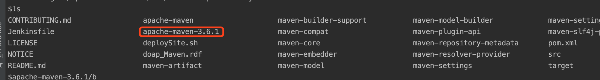
下面问题来了:
### 要在一个目录中执行另外一个目录的maven构建;
 要在一个目录中执行另外一个目录的maven构建;
即:需要在maven安装目录里面执行可以重现出来问题的项目的构建
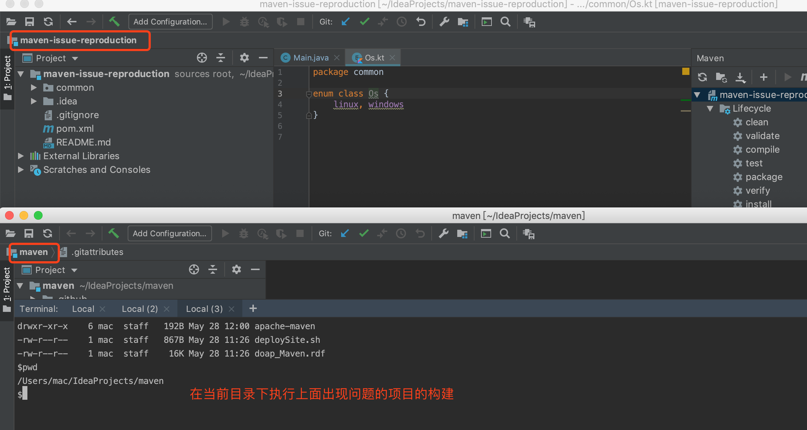
google: maven run build in another directory
[https://stackoverflow.com/questions/6478536/how-to-run-maven-from-another-directory-without-cd-to-project-dir](https://stackoverflow.com/questions/6478536/how-to-run-maven-from-another-directory-without-cd-to-project-dir)
```
$apache-maven-3.6.1/bin/mvn -f /Users/mac/IdeaProjects/maven-issue-reproduction/pom.xml compile
[INFO] Scanning for projects...
[INFO] 
[INFO] -------------------< hcsp:maven-issue-reproduction >--------------------
[INFO] Building maven-issue-reproduction 1.0-SNAPSHOT
[INFO] --------------------------------[ jar ]---------------------------------
[INFO] 
[INFO] --- kotlin-maven-plugin:1.3.0:compile (compile) @ maven-issue-reproduction ---
[ERROR] /Users/mac/IdeaProjects/maven-issue-reproduction/./common/Os.kt: (3, 12) Redeclaration: Os
[ERROR] /Users/mac/IdeaProjects/maven-issue-reproduction/common/Os.kt: (3, 12) Redeclaration: Os
[INFO] ------------------------------------------------------------------------
[INFO] BUILD FAILURE
[INFO] ------------------------------------------------------------------------
[INFO] Total time: 4.553 s
[INFO] Finished at: 2020-05-28T12:55:13+08:00
[INFO] ------------------------------------------------------------------------
[ERROR] Failed to execute goal org.jetbrains.kotlin:kotlin-maven-plugin:1.3.0:compile (compile) on project maven-issue-reproduction: Compilation failure: Compilation failure: 
[ERROR] /Users/mac/IdeaProjects/maven-issue-reproduction/./common/Os.kt:[3,12] Redeclaration: Os
[ERROR] /Users/mac/IdeaProjects/maven-issue-reproduction/common/Os.kt:[3,12] Redeclaration: Os
[ERROR] -> [Help 1]
[ERROR] 
[ERROR] To see the full stack trace of the errors, re-run Maven with the -e switch.
[ERROR] Re-run Maven using the -X switch to enable full debug logging.
[ERROR] 
[ERROR] For more information about the errors and possible solutions, please read the following articles:

```
下面就可以进行二分查找bug了;(上面已经确定了3.6.1的版本是有bug的)
```
$git bisect bad
You need to start by "git bisect start"
Do you want me to do it for you [Y/n]? y
$git checkout maven-3.6.0
Previous HEAD position was d66c9c0b3 [maven-release-plugin] prepare release maven-3.6.1
HEAD is now at 97c98ec64 [maven-release-plugin] prepare release maven-3.6.0


```
下面为3.6.0打包:
```
$mvn package -DskipTests
[INFO] Scanning for projects...
[INFO] ------------------------------------------------------------------------
[INFO] Reactor Build Order:
[INFO] 
[INFO] Apache Maven [pom]
[INFO] Maven Model [jar]
[INFO] Maven Artifact [jar]
[INFO] Maven Plugin API [jar]
[INFO] Maven Builder Support [jar]
[INFO] Maven Model Builder [jar]
[INFO] Maven Settings [jar]
[INFO] Maven Settings Builder [jar]
[INFO] Maven Repository Metadata Model [jar]
[INFO] Maven Artifact Resolver Provider [jar]
[INFO] Maven Core [jar]
[INFO] Maven SLF4J Simple Provider [jar]
[INFO] Maven Embedder [jar]
[INFO] Maven Compat [jar]
[INFO] Apache Maven Distribution [pom]
[INFO] 
[INFO] -----------------------< org.apache.maven:maven >-----------------------
[INFO] Building Apache Maven 3.6.0 [1/15]
[INFO] --------------------------------[ pom ]---------------------------------
。。。
[INFO] Maven Compat ....................................... SKIPPED
[INFO] Apache Maven Distribution .......................... SKIPPED
[INFO] ------------------------------------------------------------------------
[INFO] BUILD FAILURE
[INFO] ------------------------------------------------------------------------
[INFO] Total time: 10.320 s
[INFO] Finished at: 2020-05-28T13:00:52+08:00
[INFO] ------------------------------------------------------------------------
[ERROR] Failed to execute goal org.apache.rat:apache-rat-plugin:0.12:check (rat-check) on project maven: Too many files with unapproved license: 1 See RAT report in: /Users/mac/IdeaProjects/maven/target/rat.txt -> [Help 1]
[ERROR] 
[ERROR] To see the full stack trace of the errors, re-run Maven with the -e switch.
[ERROR] Re-run Maven using the -X switch to enable full debug logging.
[ERROR] 
[ERROR] For more information about the errors and possible solutions, please read the following articles:

```
这个检查可以忽略:
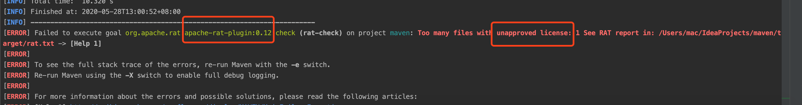
google一下:apache-rat-plugin skip
重新执行一下打包命令:
```
#在切换版本的时候在target目录里面可能会残留一些上一次构建所遗留下来的文件
$mvn clean  package -DskipTests -Drat.skip=true
```
### 小结
到目前为止所做的事情:
0.将maven这个项目clone到本地;
1.切换到3.6.1版本(`git checkout maven-3.6.1`)===>打包`mvn package -DskipTests`===>找到包(`find . -name '*.zip'`)===>解压缩(`unzip path/xxx.zip -d . `)
这里为`unzip ./apache-maven/target/apache-maven-3.6.1-bin.zip -d .`
2.在当前项目下面执行可以重现出来问题的项目的构建
```
apache-maven-3.6.1/bin/mvn -f /Users/mac/IdeaProjects/maven-issue-reproduction/pom.xml compile
发现错误
```
3.进行二分查找
```
$git bisect bad
You need to start by "git bisect start"
Do you want me to do it for you [Y/n]? y
## 切换到一个知道的没有bug的版本
$git checkout maven-3.6.0
Previous HEAD position was d66c9c0b3 [maven-release-plugin] prepare release maven-3.6.1
HEAD is now at 97c98ec64 [maven-release-plugin] prepare release maven-3.6.0
##为没有bug的版本打包
$mvn clean package -DskipTests -Drat.skip=true
[INFO] Building zip: /Users/mac/IdeaProjects/maven/apache-maven/target/apache-maven-3.6.0-bin.zip
[INFO] Building tar: /Users/mac/IdeaProjects/maven/apache-maven/target/apache-maven-3.6.0-bin.tar.gz
[INFO] ------------------------------------------------------------------------
[INFO] Reactor Summary for Apache Maven 3.6.0:
[INFO] 
[INFO] Apache Maven ....................................... SUCCESS [ 2.149 s]
[INFO] Maven Model ........................................ SUCCESS [ 3.956 s]
[INFO] Maven Artifact ..................................... SUCCESS [ 1.000 s]
[INFO] Maven Plugin API ................................... SUCCESS [ 0.947 s]
[INFO] Maven Builder Support .............................. SUCCESS [ 0.386 s]
[INFO] Maven Model Builder ................................ SUCCESS [ 1.717 s]
[INFO] Maven Settings ..................................... SUCCESS [ 0.533 s]
[INFO] Maven Settings Builder ............................. SUCCESS [ 0.614 s]
[INFO] Maven Repository Metadata Model .................... SUCCESS [ 0.405 s]
[INFO] Maven Artifact Resolver Provider ................... SUCCESS [ 26.063 s]
[INFO] Maven Core ......................................... SUCCESS [ 4.232 s]
[INFO] Maven SLF4J Simple Provider ........................ SUCCESS [ 0.797 s]
[INFO] Maven Embedder ..................................... SUCCESS [ 1.464 s]
[INFO] Maven Compat ....................................... SUCCESS [ 2.330 s]
[INFO] Apache Maven Distribution .......................... SUCCESS [04:44 min]
[INFO] ------------------------------------------------------------------------
[INFO] BUILD SUCCESS
[INFO] ------------------------------------------------------------------------
[INFO] Total time: 05:30 min
[INFO] Finished at: 2020-05-28T13:17:51+08:00
[INFO] ------------------------------------------------------------------------

## 而后解压
$unzip /Users/mac/IdeaProjects/maven/apache-maven/target/apache-maven-3.6.0-bin.zip -d .
## 继续在当前目录下执行出错的那个项目的构建
$apache-maven-3.6.0/bin/mvn -f /Users/mac/IdeaProjects/maven-issue-reproduction/pom.xml compile
[INFO] Scanning for projects...
[INFO] 
[INFO] -------------------< hcsp:maven-issue-reproduction >--------------------
[INFO] Building maven-issue-reproduction 1.0-SNAPSHOT
[INFO] --------------------------------[ jar ]---------------------------------
[INFO] 
[INFO] --- kotlin-maven-plugin:1.3.0:compile (compile) @ maven-issue-reproduction ---
[INFO] 
[INFO] --- maven-resources-plugin:2.6:resources (default-resources) @ maven-issue-reproduction ---
[INFO] Using 'UTF-8' encoding to copy filtered resources.
[INFO] skip non existing resourceDirectory /Users/mac/IdeaProjects/maven-issue-reproduction/src/main/resources
[INFO] 
[INFO] --- maven-compiler-plugin:3.1:compile (default-compile) @ maven-issue-reproduction ---
[INFO] Changes detected - recompiling the module!
[INFO] Compiling 1 source file to /Users/mac/IdeaProjects/maven-issue-reproduction/target/classes
[INFO] ------------------------------------------------------------------------
[INFO] BUILD SUCCESS
[INFO] ------------------------------------------------------------------------
[INFO] Total time: 4.991 s
[INFO] Finished at: 2020-05-28T13:29:19+08:00
[INFO] ------------------------------------------------------------------------
## 再一次使用git bisect命令
$git bisect good
Bisecting: 27 revisions left to test after this (roughly 5 steps)
[2928dc6b68660cc5ac4022b0bfbc84d51d6905e4] refactoring: extracted initParent() method

```
到目前为止,已经知道了差不多有多少步可以精确定位到那个bug,(5步27次提交)
下面可以使用自动化工具来实现,手工太麻烦了;
## 自动化实现
回顾一下上面的流程:
`mvn package`===>`unzip path/xxx.zip -d .`===>`apache-maven-3.6.X/bin/mvn -f path1/haveBugProject/pom.xml compile`
注意,上面这个流程里面,有个目录是变化的;
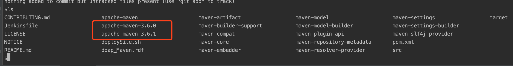
`apache-maven-3.6.X`这个是需要通过从当前版本中获取的;
就在pom.xml里面:
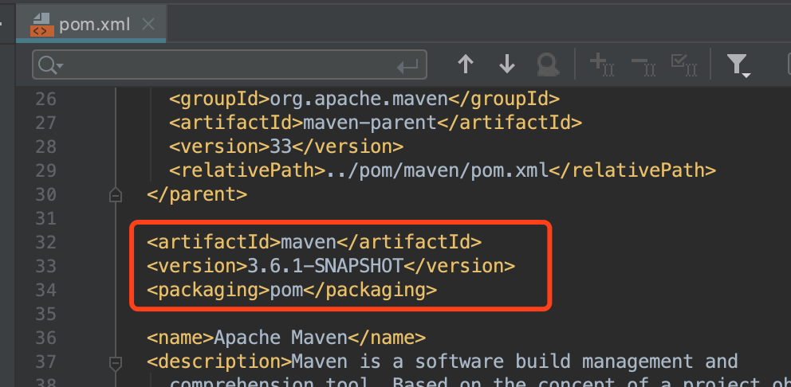
这就需要通过脚本自动化获取这个版本,才能拿到正确的版本;
通过搜索来解决吧:
google：maven get version bash
[https://stackoverflow.com/questions/3545292/how-to-get-maven-project-version-to-the-bash-command-line](https://stackoverflow.com/questions/3545292/how-to-get-maven-project-version-to-the-bash-command-line)
`mvn help:evaluate -Dexpression=project.version -q -DforceStdout`获取当前maven版本的shell命令
run.sh如下:
在类unix系统里面程序正确退出会返回0,否则返回非0;
```
#!/bin/sh

VERSION=$(mvn help:evaluate -Dexpression=project.version -q -DforceStdout)
rm -rf apache-maven-* &&\
mvn clean package -DskipTests -Drat.skip=true &&\
unzip /Users/mac/IdeaProjects/maven/apache-maven/target/apache-maven-$VERSION-bin.zip -d . &&\
apache-maven-$VERSION/bin/mvn -f /Users/mac/IdeaProjects/maven-issue-reproduction/pom.xml compile
```
注意此时是切换到3.6.0来运行run.sh的
```
$git checkout maven-3.6.0
```
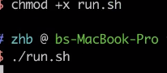

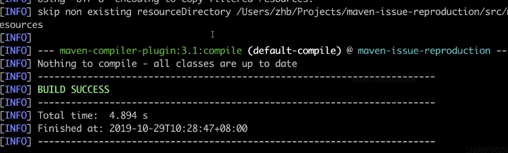

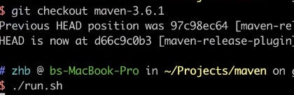

3.6.1发现错误(这是在预期中的)
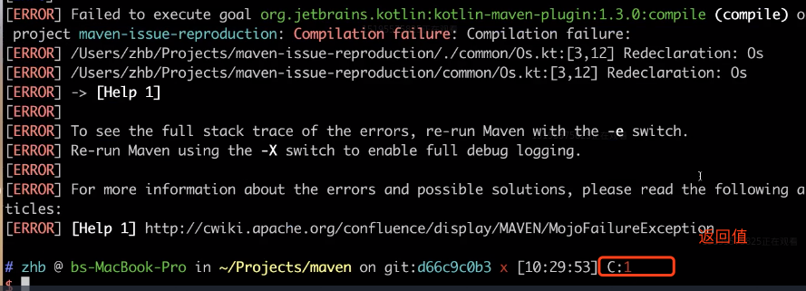
 开始二分查找:
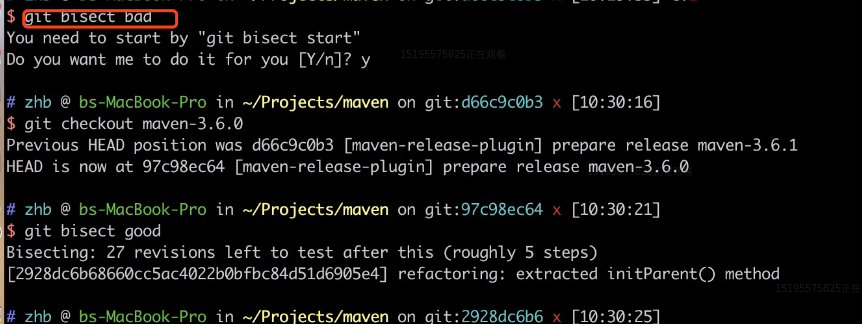
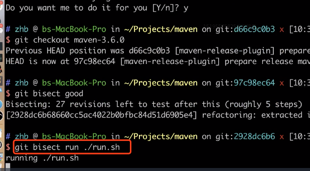
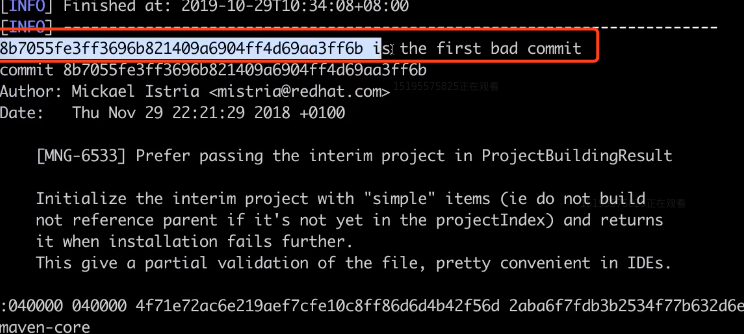

## 总结
使用git bisect 找到是谁在哪个时间点的commit把这个bug引入的！！
1.先找到两个版本,一个是好的,一个是有bug的;
2.手工测试完一两个之后可以写一个脚本将这个过程自动化
3.为了测试自动化脚本有没问题,可以分别切换到好的版本上和坏的版本上,运行run.sh
4.使用git bisect good/bad 告诉git;
4.使用`git bisect run ./run.sh` 查找问题

## 脚本分析(更新后的脚本,好像有点问题)
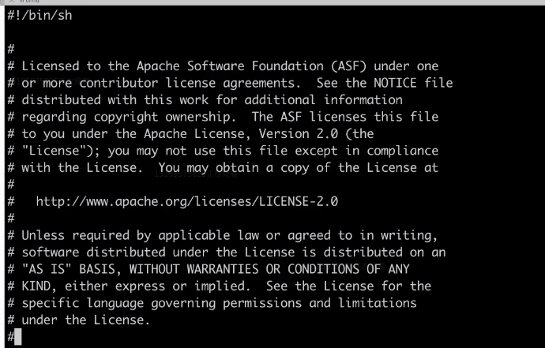
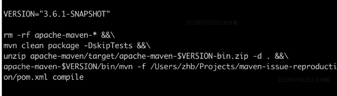
注意如果没有上面这个许可证,会报下面这个错误:(比如在运行`mvn clean package`的时候)
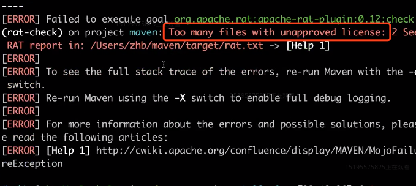

```
#!/bin/sh

# Licensed to the Apache Software Foundation (ASF) under one
# or more contributor license agreements.  See the NOTICE file
# distributed with this work for additional information
# regarding copyright ownership.  The ASF licenses this file
# to you under the Apache License, Version 2.0 (the
# "License"); you may not use this file except in compliance
# with the License.  You may obtain a copy of the License at
#
#   [http://www.apache.org/licenses/LICENSE-2.0](http://www.apache.org/licenses/LICENSE-2.0)
#
# Unless required by applicable law or agreed to in writing,
# software distributed under the License is distributed on an
# "AS IS" BASIS, WITHOUT WARRANTIES OR CONDITIONS OF ANY
# KIND, either express or implied.  See the License for the
# specific language governing permissions and limitations
# under the License.
#

VERSION="3.6.1-SNAPSHOT"
rm -rf apache-maven-* &&\
mvn clean package -DskipTests &&\
unzip /Users/mac/IdeaProjects/maven/apache-maven/target/apache-maven-$VERSION-bin.zip -d . &&\
apache-maven-$VERSION/bin/mvn -f /Users/mac/IdeaProjects/maven-issue-reproduction/pom.xml compile

```
## 一个licesence问题(Too many files with unapproved license)
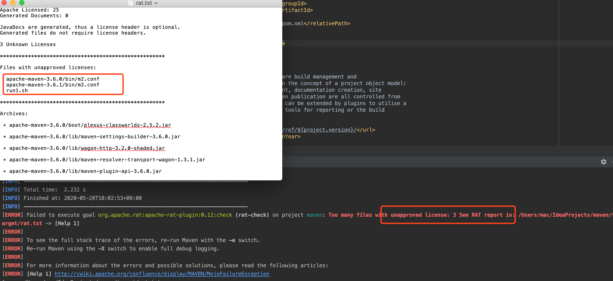
打开rat.txt,发现了有三个文件没有licenses,将这三个文件删掉即可;
```
rm run1.sh
$rm -rf apache-maven-3.6.1
$rm -rf apache-maven-3.6.0
而后运行下面命令没问题
$mvn clean package -DskipTests

```

