[TOC]
## 前言
GitHub的基本结构
在GitHub中导航
按照分支、提交以及tag进行检索
GitHub资源定位链接
Raw data
包含行号的链接
查看Raw文件
查看历史
使用GitHub进行在线git操作
在Web UI上提交代码、建立分支、发起Pull request
比较两份代码（git diff）
分支管理
merge/rebase/squash and merge
检索开源项目
如何找到自己想要的开源项目
如何搜索前人提交过的问题
在GitHub中搜索代码、提交、文档
## 基本协作方式
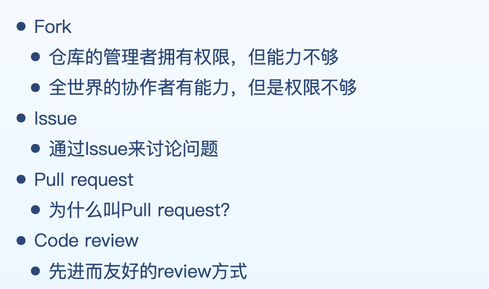

正常fork后的仓库,如果不做相关设置的话会与源仓库渐行渐远;
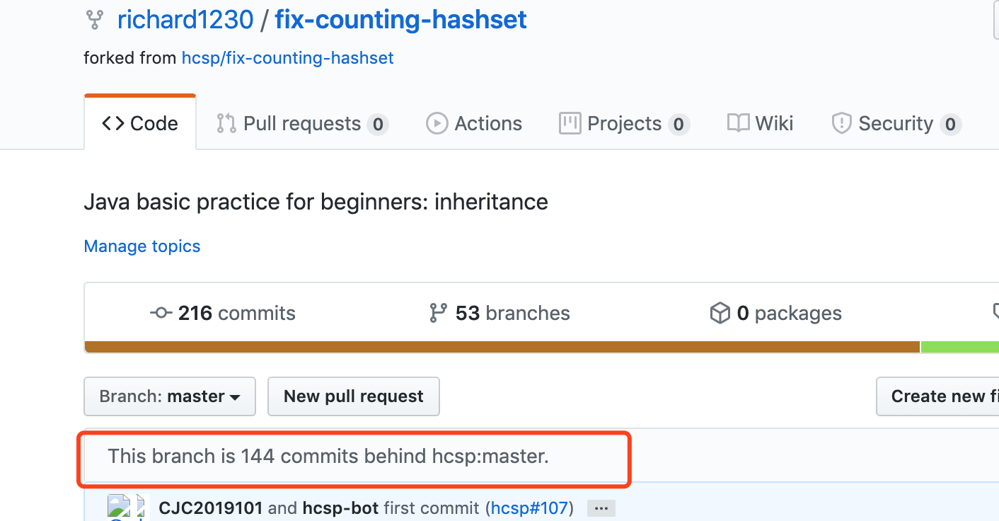
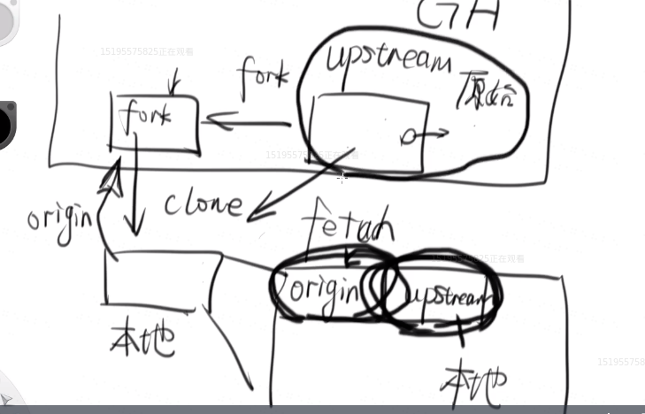
先fork一份到本地,而后clone到本地:
要想使得本地和上游的远程同步:
```
#注意:从远程clone以后,一般本地仓库有两份仓库,即:本地仓库(master)和本地远程仓库(origin/master);但是这里本地远程还有一个仓库,是upstream！！！
git remote add upstream git@源仓库
git remote
git fetch git@源仓库
git merge upstream/master
##或者用下面这一步代替上面两步
Git pull upstream/master
```
### 仓库的相关补充以及理解全量编译增量编译(重要知识点)

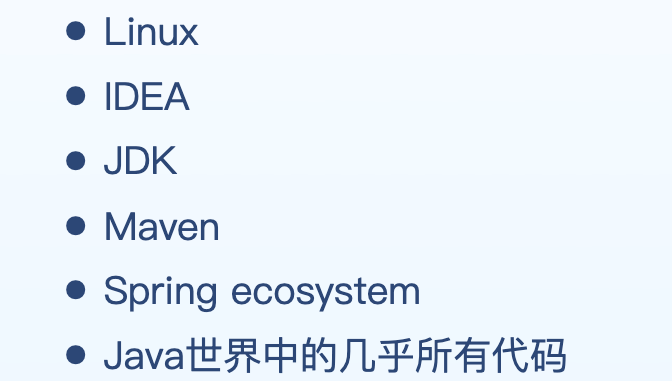
你看的任何一份代码(不管是哪个分支哪个版本,哪个提交)都只是仓库在某个时间点上的快照,
假如你想知道idea内部是如何工作的,想要去查一个bug,怎么办?
先将这份代码clone下来,clone到本地,而后可以打包出一份新的idea,
我们日常所用的任何软件,都是从某份代码的快照所生成的(打包成的)!!!
日常所用的所有软件(代码),都是通过编译生成的;
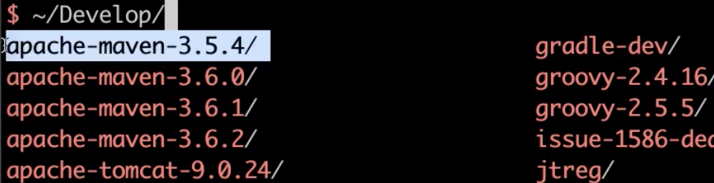
假如你想要3.5.4版本的maven,你就首先把版本切换到3.5.4,而后把这个版本的代码打个包;而后就会变成你想要的这个版本;
假如你想魔改一些功能,可以切换到对应版本,将里面的一些功能改掉,而后打包就可以用了!!!
直接从源代码编译构建出一份完整的软件的话需要很长时间;===>全量编译
增量编译:如果你只是改了两行,那么就只有这两行代码的变更会被编译;

如果你在你的代码里面引入了spring 5.2.0.release;(那么这个代码怎么来的?)
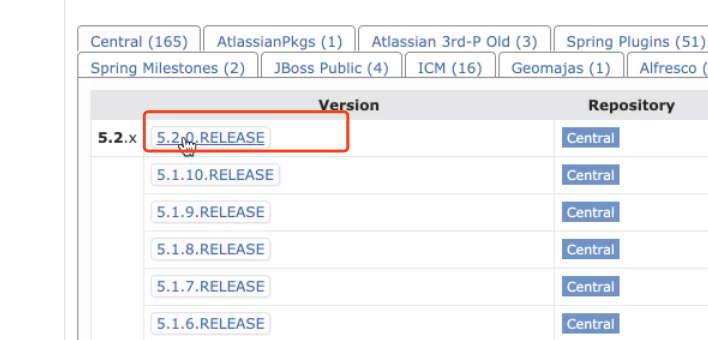
如果你在你的代码里面引入了spring 5.2.0.release;(那么这个代码怎么来的?)
看下面:
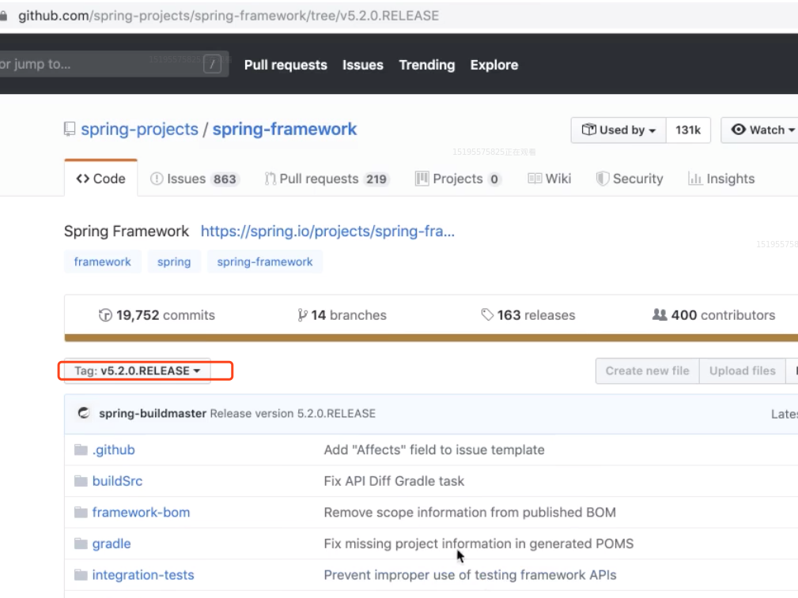 
 


 ## 从github你能获得什么

一般遇到问题,你先在issue里面搜,找不到提issue,不回复,写邮件;
怎么找邮箱??看下面:
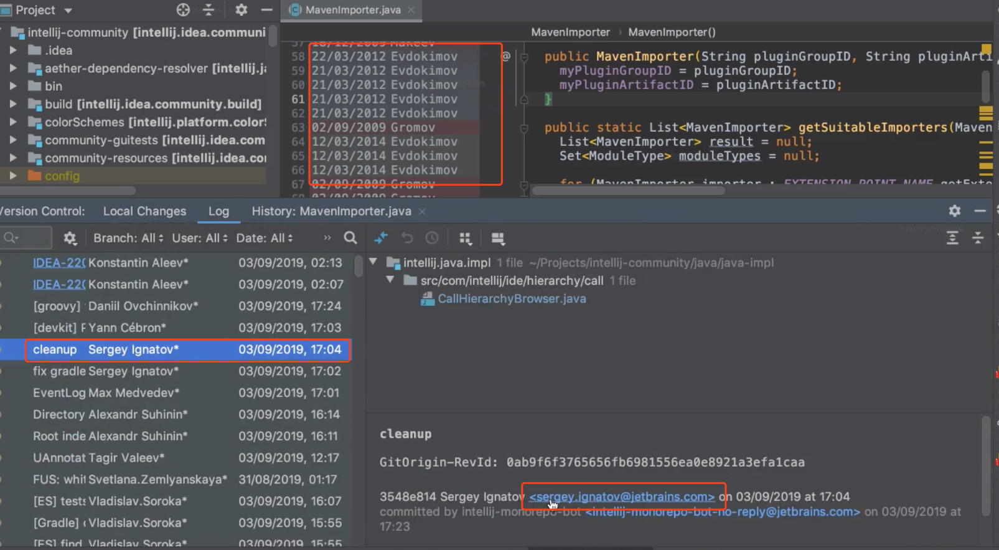

## github基本结构术语和导航
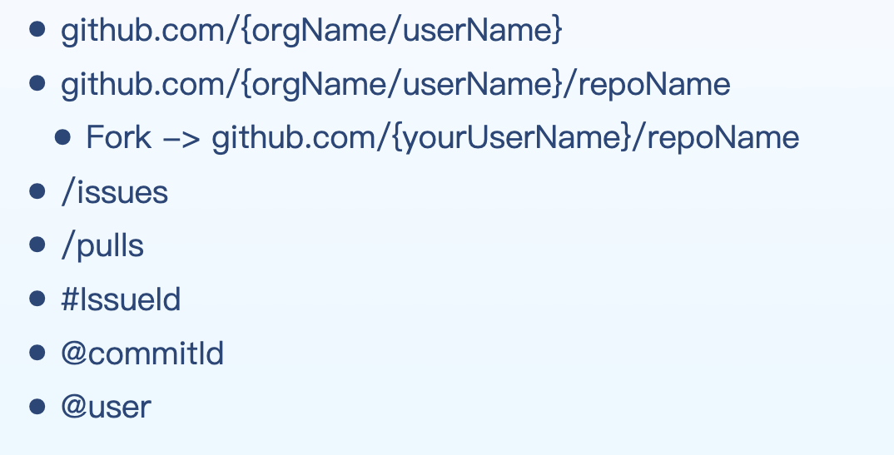


### 在github中导航
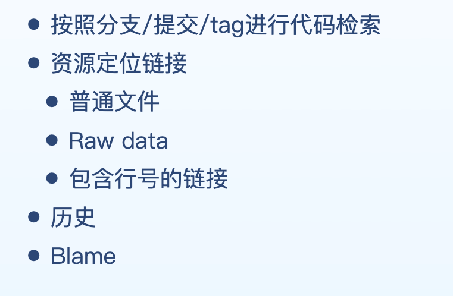
blame可以查看某一行代码是谁写的:
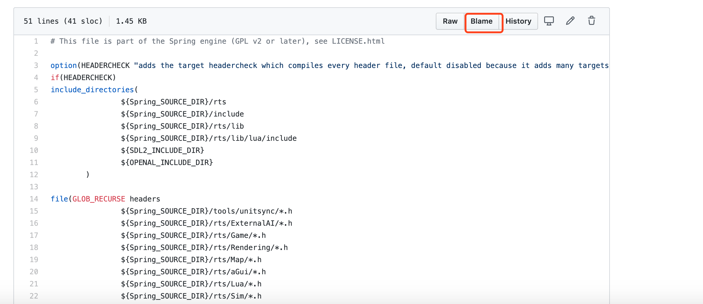

history是可以查看这个文件的所有变更的;
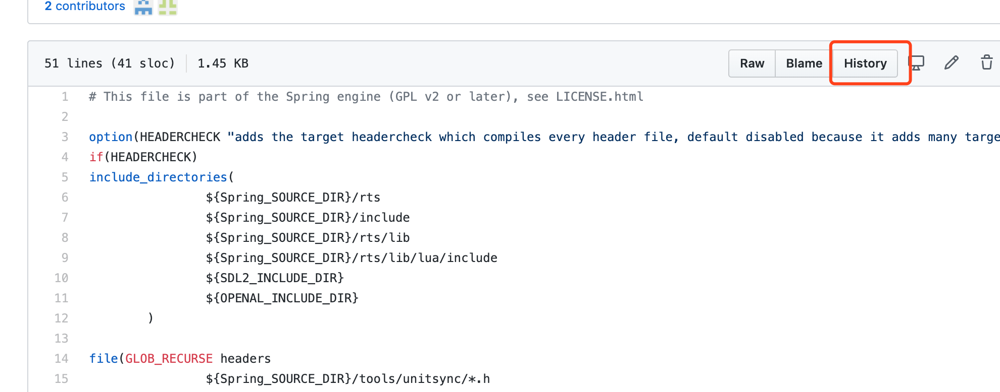
包含行号的链接:(直接点某一行即可)
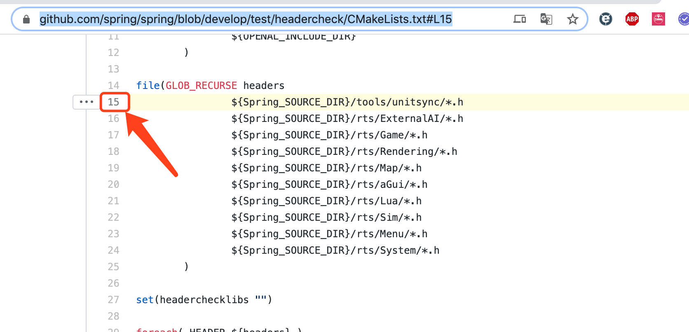
包含多行行号的链接:(自己动手加行号)
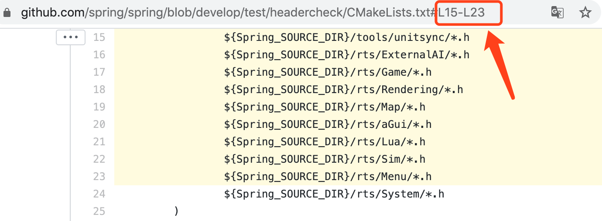

注意:发链接给别人进行code review的时候最好发利用commit进行检索的链接(此commit永远不会变,而分支之类的会变!)
分支的状态会随着时间的变化而改变!!
## 在github里面检索代码(有点意思,可以告诉你现成的轮子,怎么抄代码!!!怎么实现需求)


搜索方法:(在github站内搜索可能效果不如google)
google:create a function site:stackoverflow.com
google:create a function site:github.com
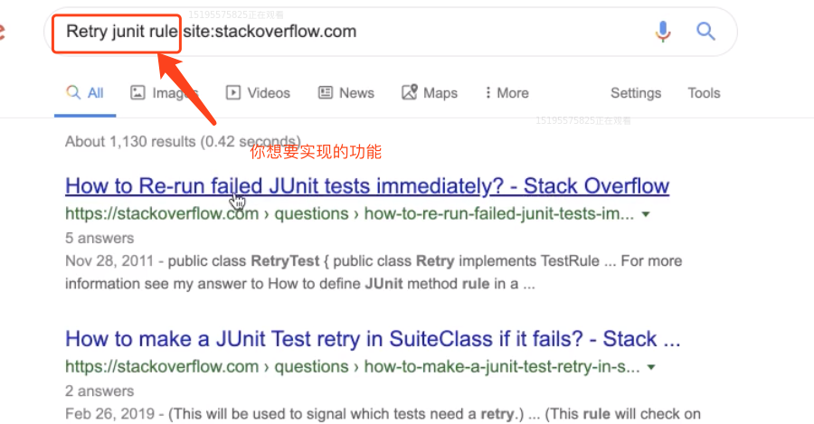

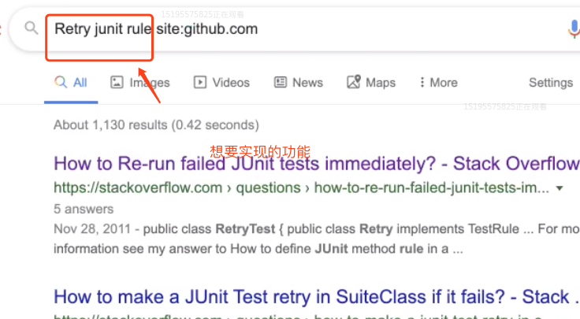 
找到了之后怎么用呢?
除了看文档,还要看测试代码!!!
## 如何从源代码构建出软件
没有通用的打包方式!!
需要看这个仓库的文档！！一般叫contributing.md
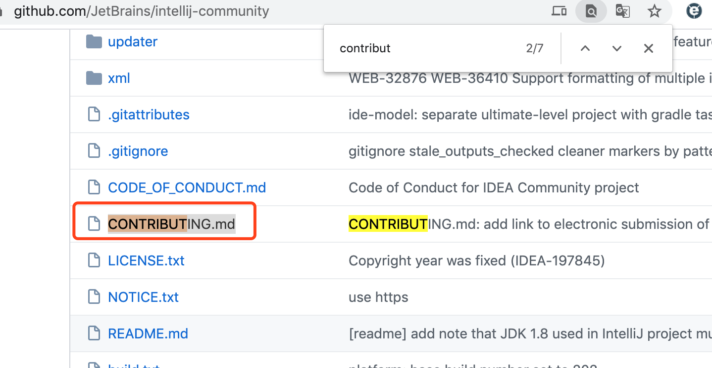

[https://openjdk.java.net/contribute/](https://openjdk.java.net/contribute/) :
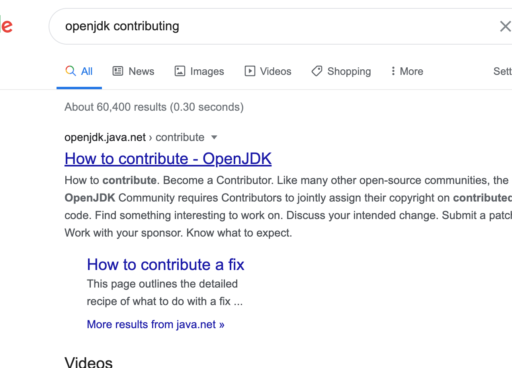


[https://hg.openjdk.java.net/jdk/jdk11/raw-file/tip/doc/building.html](https://hg.openjdk.java.net/jdk/jdk11/raw-file/tip/doc/building.html)

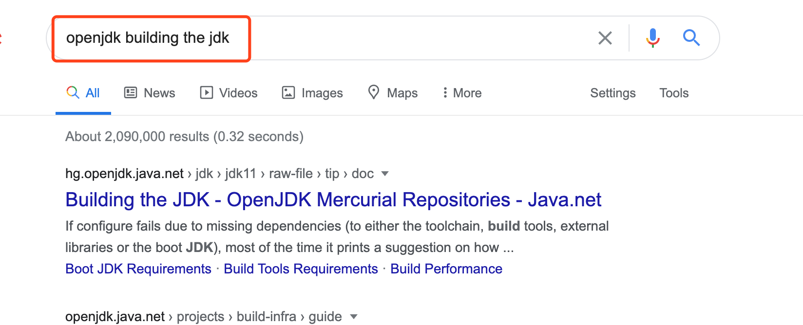


# 通过github解决调试中源代码不匹配问题
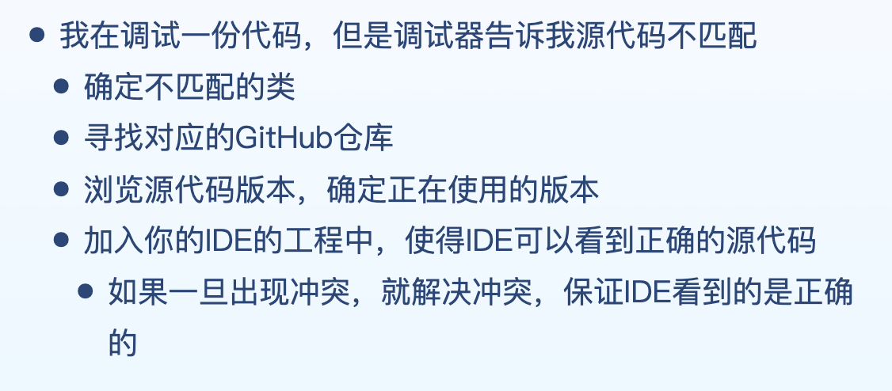

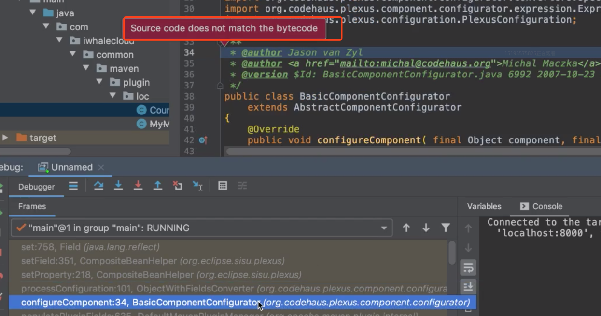
注解怎么发挥作用,取决于处理注解的那个类!!
要想知道注解什么时候设上值的;只有一种方法,那就是反射!!
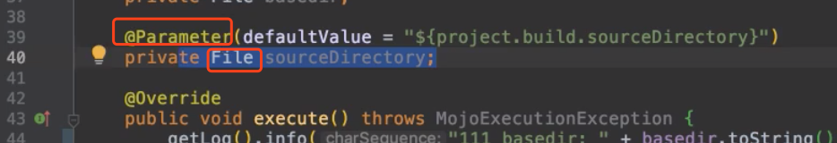
这里需要到Field类里面打条件断点;

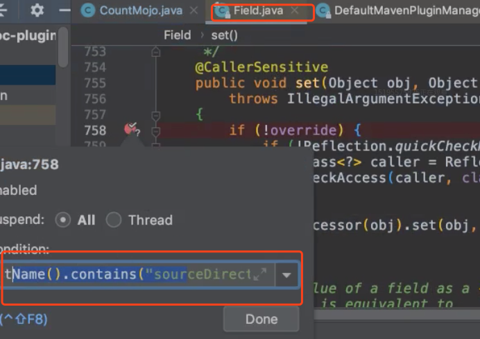
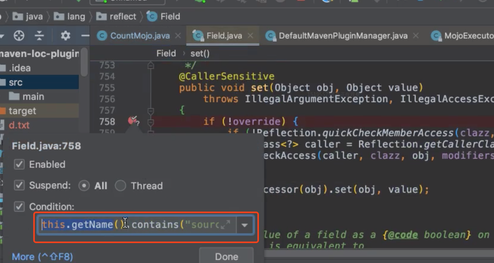
这个实战的例子在:
[https://github.com/blindpirate/maven-loc-plugin](https://github.com/blindpirate/maven-loc-plugin)
先clone一份到本地:
git@github.com:blindpirate/maven-loc-plugin.git
```
## 先将当前项目安装到本地
$mvn install
[INFO] Scanning for projects...
[INFO] 
[INFO] --------------< com.iwhalecloud.common:maven-loc-plugin >---------------
[INFO] Building Maven LOC Plugin 1.0-SNAPSHOT
[INFO] ----------------------------[ maven-plugin ]----------------------------
[INFO] 
[INFO] --- maven-resources-plugin:2.6:resources (default-resources) @ maven-loc-plugin ---
[INFO] Using 'UTF-8' encoding to copy filtered resources.
[INFO] skip non existing resourceDirectory /Users/mac/IdeaProjects/maven-loc-plugin/src/main/resources
[INFO] 
[INFO] --- maven-compiler-plugin:3.1:compile (default-compile) @ maven-loc-plugin ---
[INFO] Changes detected - recompiling the module!
[INFO] Compiling 2 source files to /Users/mac/IdeaProjects/maven-loc-plugin/target/classes
[INFO] 
[INFO] --- maven-plugin-plugin:3.2:descriptor (default-descriptor) @ maven-loc-plugin ---
```
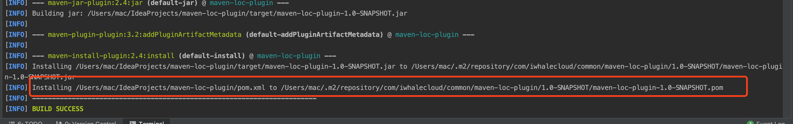
现在就相当于将当前的这个代码(就是为maven写的一个插件)打包成了一份软件
 
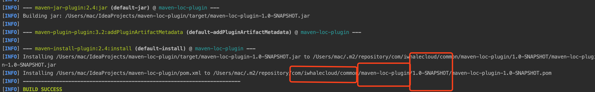
其他软件项目也就可以用它了;
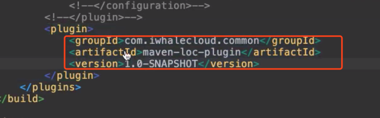
回到正题:
当jvm里面跑的代码和IDE里面运行的源代码不是同一份代码的时候,就会报上面的源代码与字节码不匹配 的字样!!


现在调试一个mvn插件;
当你任意输入一个mvn命令的时候, mvn会起一个jvm进程;(tomcat,elastic都是启动一个jvm进程)
IDE既然可以调试自己启动的jvm进程,那也可以调试别人启动的jvm进程;
因此,只需要在这个进程启动的时候告诉它,可能有人来调试你,不要着急马上就启动! 
你(mvn)现在以调试模式启动,让ide连上来即可!!!   
 
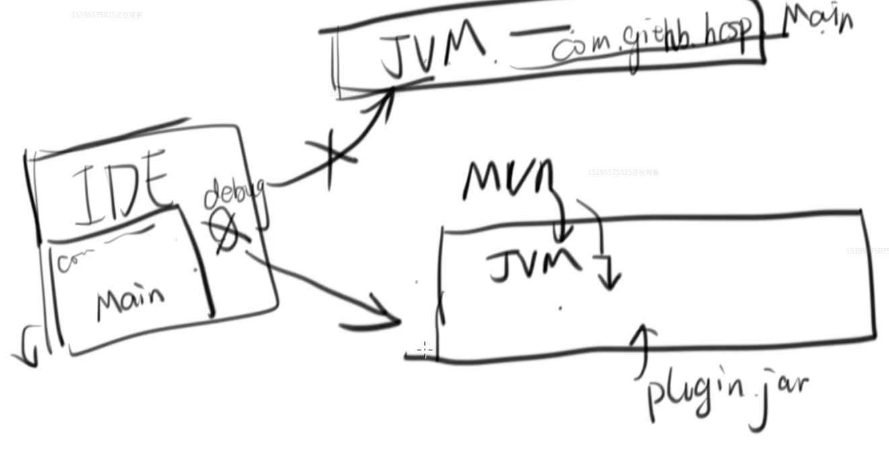

下面是以mvn运行这个插件:
```
$mvn com.iwhalecloud.common:maven-loc-plugin:1.0-SNAPSHOT:loc
[INFO] Scanning for projects...
[INFO] 
[INFO] --------------< com.iwhalecloud.common:maven-loc-plugin >---------------
[INFO] Building Maven LOC Plugin 1.0-SNAPSHOT
[INFO] ----------------------------[ maven-plugin ]----------------------------
[INFO] 
[INFO] --- maven-loc-plugin:1.0-SNAPSHOT:loc (default-cli) @ maven-loc-plugin ---
[INFO] basedir: /Users/mac/IdeaProjects/maven-loc-plugin
[INFO] sourceDirectory: /Users/mac/IdeaProjects/maven-loc-plugin/src/main/java
[INFO] ------------------------------------------------------------------------
[INFO] BUILD SUCCESS
[INFO] ------------------------------------------------------------------------
[INFO] Total time: 0.289 s
[INFO] Finished at: 2020-05-29T12:07:30+08:00
[INFO] ------------------------------------------------------------------------
```
现在以调试器的方式来启动它:(注意,下面这个命令是运行在使用这个插件的项目里面的！！！)
```
$mvnDebug com.iwhalecloud.common:maven-loc-plugin:1.0-SNAPSHOT:loc

```
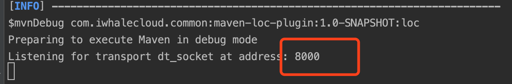
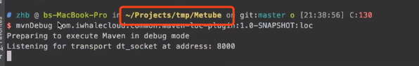


下面注意了:下面这个端口设置是在你自己写的插件(可以理解为依赖库里面)项目里面;
运行debug也是在你自己写的插件项目里面的！！！
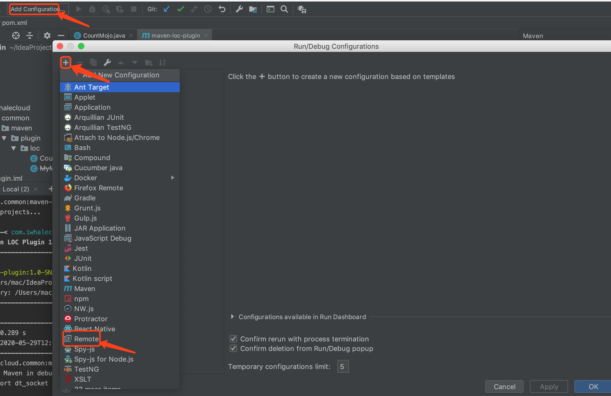

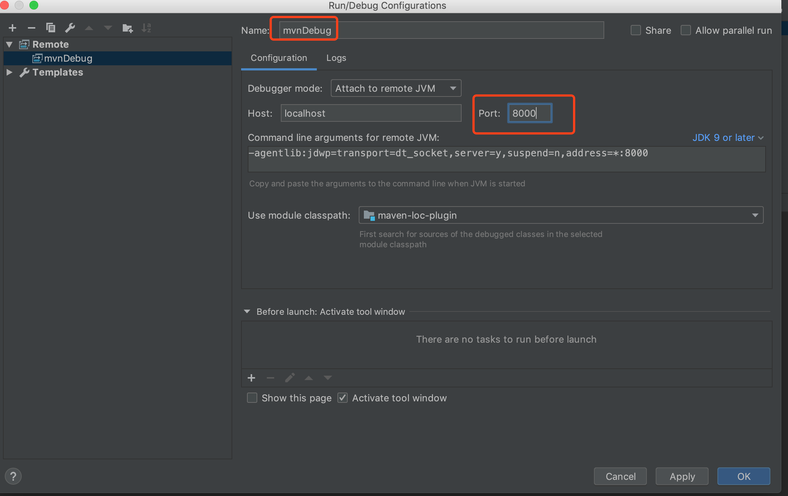

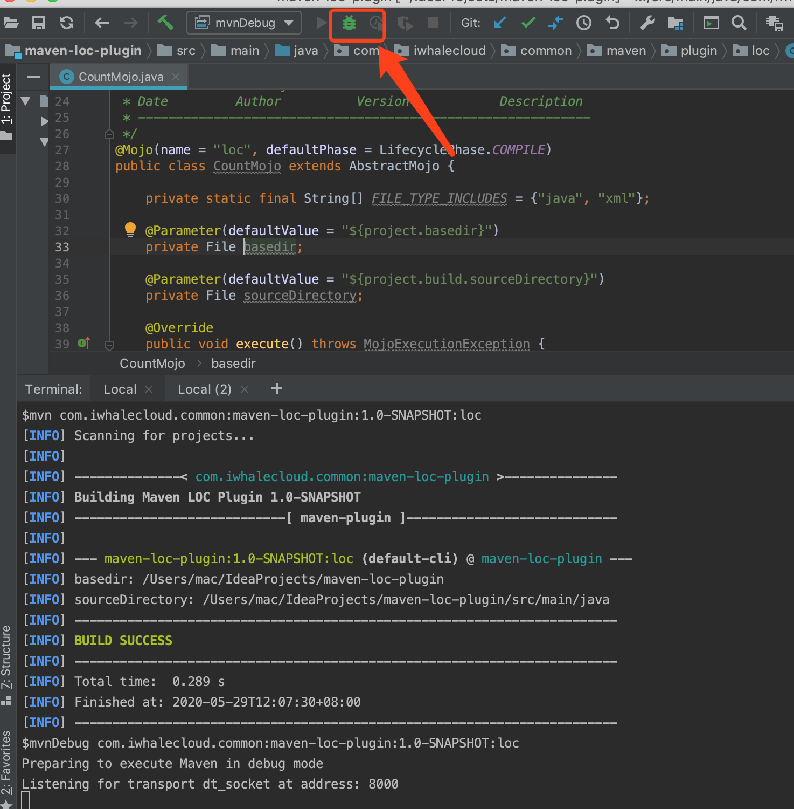


注意:前面是需要在field包里面打断点的:(为什么在set方法这里呢,因为之前的那个问题是想要弄清楚是谁在注解那边设值的!!)


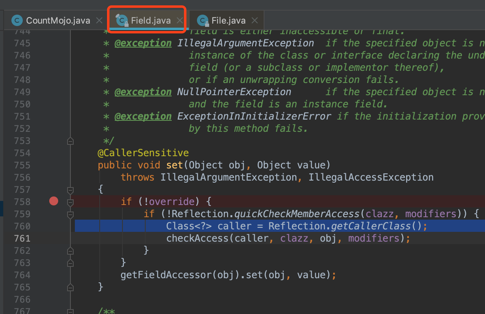

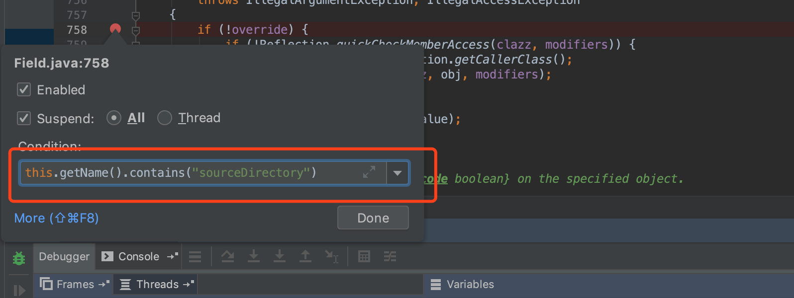
断点停了:
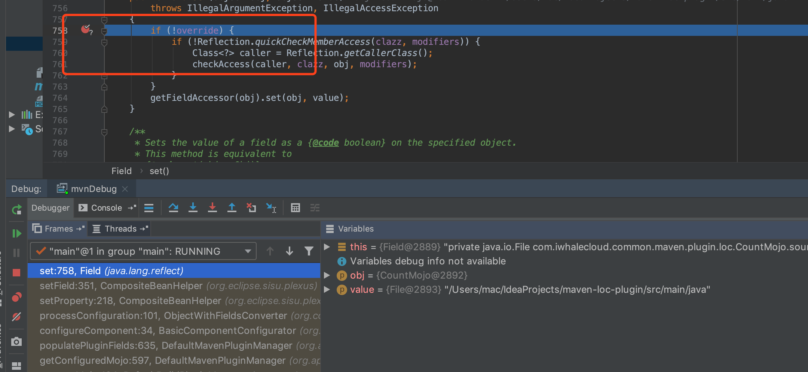
 出现源代码与字节码不一样了:
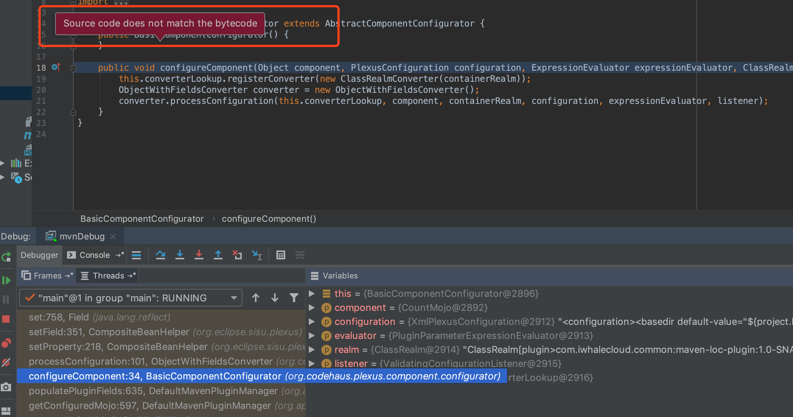
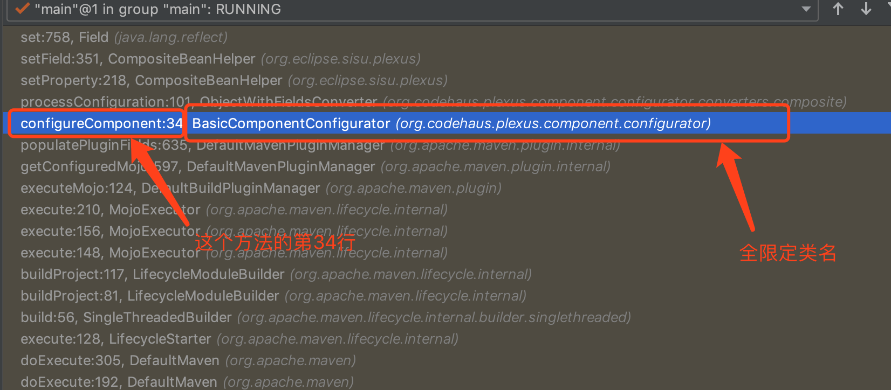
解决方法:
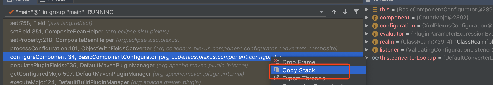
现在的问题是:
mvn启动了一个jvm,在jvm里面运行的源代码的字节码和IDE调试的这个源代码匹配不上(虽然他们的全限定类名一样!!)
IDE只是负责加载这个项目所配置的jar包,而mvn里面加载了什么jar包,ide是不知道的!!
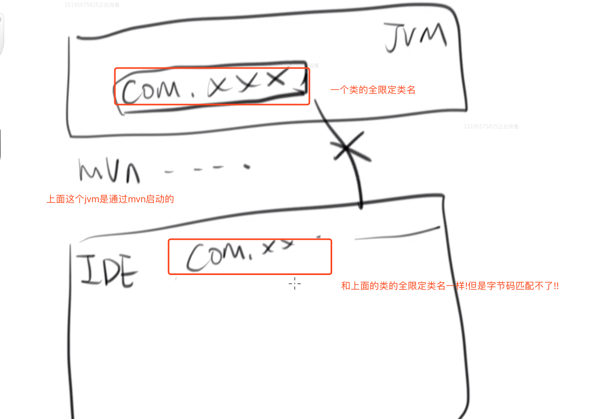


将上面copy stack丢到google里面:

org.codehaus.plexus.component.configurator.BasicComponentConfigurator
或者:
org.codehaus.plexus.component.configurator.BasicComponentConfigurator site:github.com
还可以这么搜源代码:
org.codehaus.plexus.component.configurator site:github.com
锁定到这里:
[https://github.com/eclipse/sisu.plexus/blob/master/org.eclipse.sisu.plexus/src/org/codehaus/plexus/component/configurator/BasicComponentConfigurator.java](https://github.com/eclipse/sisu.plexus/blob/master/org.eclipse.sisu.plexus/src/org/codehaus/plexus/component/configurator/BasicComponentConfigurator.java)
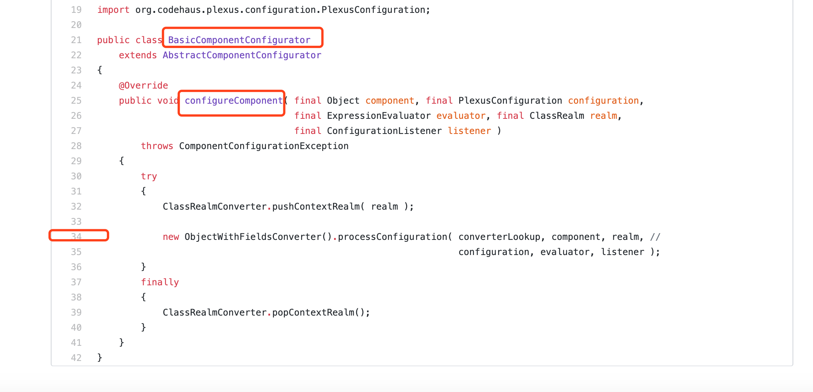


IDE里面的不正确的源代码:
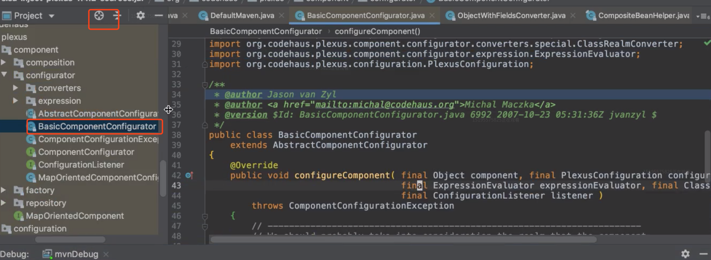
### 下面需要引入正确的代码了!!(重点)
只需要在pom.xml里面写dependency;
切换到0.3.3版本:


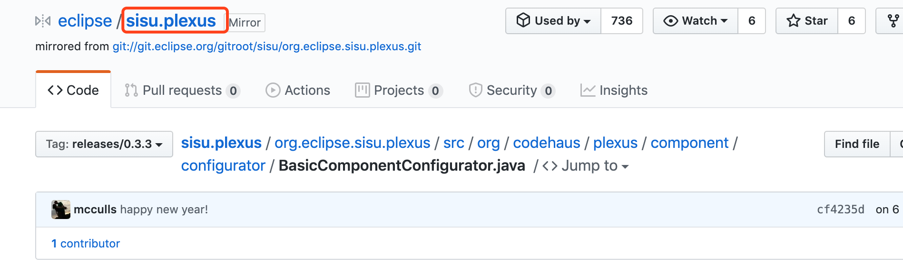
发现是对 的:(说明0.3.3这个版本可以使用！！！)
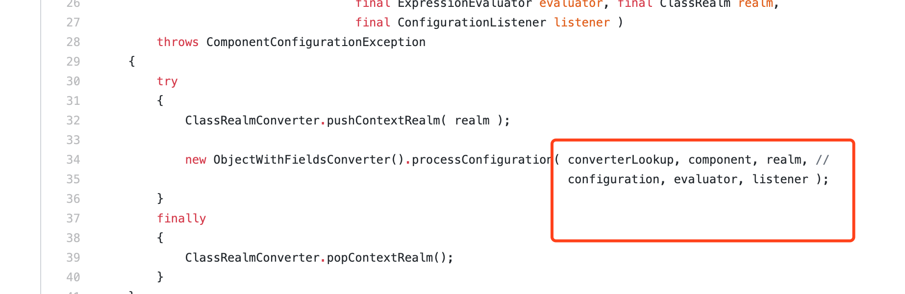
google: sisu.plexus 0.3.3 maven
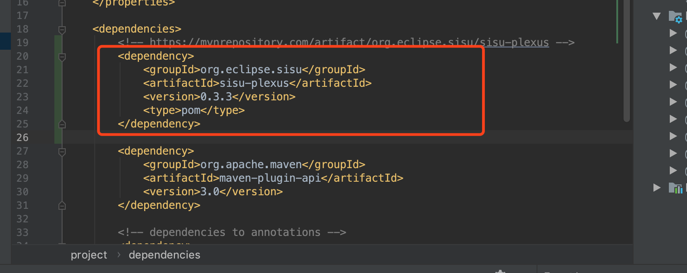

发现此时还是不对:
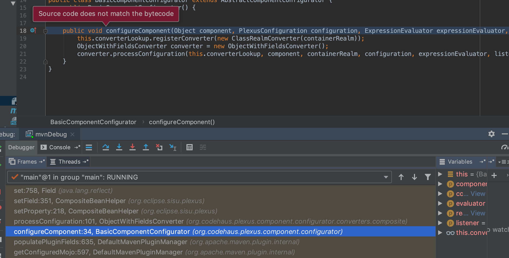

下面解决包冲突:(我们希望下面这个不对的代码被我们刚刚引入的包覆盖掉!!!)
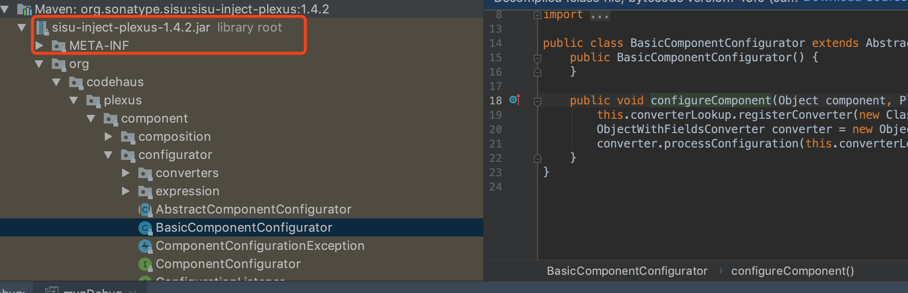

发现原来不对的的代码还在:(我们想要把这个不对的删掉！！！)
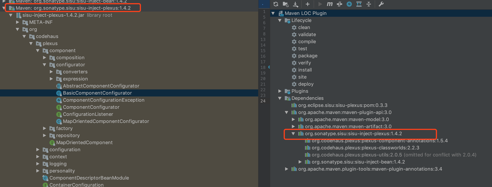

现在最关键的是需要找到这个不好的代码是谁导入进来的!
```
$mvn dependency:tree > d.txt
```
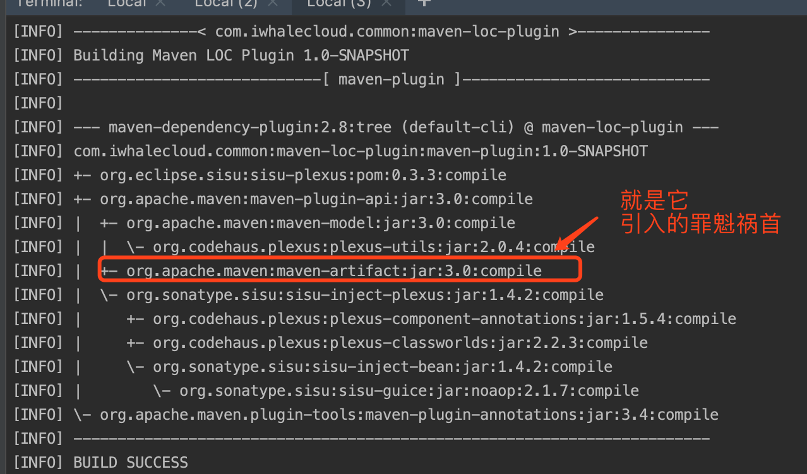
所以要做`org.apache.maven:maven-plugin-api:jar:3.0:compile`这个依赖里面将
`org.sonatype.sisu:sisu-inject-plexus:jar:1.4.2:compile`排除！！！
发现原来的坏代码终于没了;
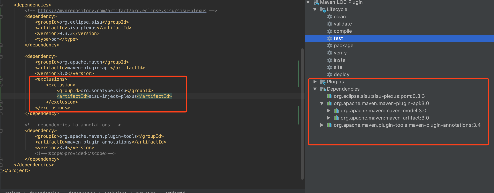

再次回到项目里面:重复之前的操作(注意:这里是在项目里面,不是写插件的那个项目,是用这个插件的项目?)


现在恢复正常了:

# 查找任意感兴趣的代码(重要)
我在调试⼀份代码,但是这份代码不不知道从哪里来的
确定类名 
寻找对应的GitHub仓库 
浏览源代码版本,确定正在使⽤的版本

## 看前面的一个例子:

报错了:


看到丢出异常了:


### 看到的每一个异常类都可以在github上面找到源代码:


google搜索:
org.apache.xxx.yyy site;github.com 


于是乎可以将maven仓库下载下来:


现在问题来了:
出错的这个版本是你下载下来的那个版本呢?? ===>(3.6.1鸭,刚刚运行的时候就是用的3.6.1版本)

现在需要切换到3.6.1版本看它发生了什么问题导致报了上面这么一个错!
 
 下面打开这个类的215行:


打个断点:


和前面那个例子,去调试:(这里就不展开讲调试了)


### 要想知道下面这个类是哪儿来？看下面:
方法同前google搜索类名+site:github.com


此时 说明版本对不上号!!
怎么找到一个正确的版本号呢?
这里介绍一种方法:
由于你这里报错的类是maven的依赖,故这里应该在maven-3.6.1的lib文件里面去找:

找到本地的plexus-classworlds这个库的对应版本而后在github上将其切换至对应的版本即可;

### 想要调试直接丢出来 的一个异常

方法和前面一模一样:
先搜到源代码;


clone到本地,而后打开它:

下面问题来了:怎么找到报错的那个代码的正确版本?
解决办法:查看出错的那个项目的pom.xml(直接丢出错误的这个类其实是这个出错的项目所依赖的一个库里面的一个类,pom在引用的时候肯定标注了其版本!!!)

发现是1.3.0版本;

切换到1.3.0版本:

而后切换到下面这个类的111行附近,打断点debug:

注意:打断点的地方是依赖库这个项目,不是出问题的那个项目;

在出错的项目里面debug:

在依赖库这个项目里面设置端口:

在依赖库这个项目里面开启调试:(可以看到即使爆红也可以进行调试,哈哈)


## 小结(上面的两个例子调试逻辑总结)
一般是在出错的项目里面运行`mvn xxx `等调试命令,在依赖库项目里面打断点,并且运行调试！！！
## 确定jvm里面运行的任何代码的正确版本
问题:不知道这个类是从哪里来的,他的版本号是什么??

解决方案:
首先需要确保让你的jvm停在一个地方;
随便找了一个方便的地方??

运行mvndebug:


停在了这个下断点的地方:


### 方案1来了:

强行加载你想要知道的那个类!!!


github上面发现没有找到对应的版本;就找一个版本最接近的:


其实人家已经有提示了:(移到其他地方了 )


### 方案2:

接着方案1的表达式继续利用gitResource获取资源;
`Class.forName("xxx.yyy.zzz.qqq.www").getResource("xxx/yyy/zzz/qqq/www.class")`

 


# 在包冲突时检索正确版本的代码


NoSuchMethodError说明有包冲突发生了!


按照最近原则,c0.2被忽略;

直接搜索报错的这个方法的类:(实在不行就去中央仓库)


找到c0.1和c0.2之间的区别:而后发现需要的是c0.2,实际上加载的是c0.1
解决方案:(详见地20课)
将c0.1排除即可